# 05 — Project Schedule

> **File hasil generator** — jangan diedit manual. Sumber: `tools/build_plan.py`. Koordinator integrasi yang dipakai: Role B (R2) (HD-02, disetujui GATE-EP 2026-11-19). Kapasitas: HD-03 + HD-07(b).

Kalender: D1 = 2026-11-19 … D21 = 2026-12-09 (A-22, `ASSUMPTION`). Penjadwalan mulai **D2**; D1 dipakai untuk Fase 0 dan awal Fase 1 (dikerjakan agen).
Kapasitas (GATE-EP, HD-03 + HD-07b): 4 jam/hari/orang setiap hari termasuk akhir pekan; **R1 dan R3 ±5 jam/hari pada D9–D15** (rantai kritis). Opsi (c) potong *Should* tetap menjadi cadangan.
Metode: penjadwalan berbasis sumber daya (satu orang per peran, 4 jam kerja = 1 hari), prioritas = jalur terpanjang ke akhir, durasi = PERT. Persetujuan gerbang dianggap selesai di akhir hari; tugas yang menunggu gerbang mulai keesokan harinya.

## 1. Milestone

| Milestone | Rencana (hasil jadwal) | Target charter |
|---|---|---|
| GATE-EP — Persetujuan rencana eksekusi (dokumen ini) + penetapan anggota/peran | D2 (2026-11-20) | D2 |
| GATE-G1 — G1 — dataset, periode (OQ-05), batas provinsi (OQ-07), aturan NRT/SP, aturan DQ | D3 (2026-11-21) | D2–D3 |
| GATE-G2 — G2 — requirements, NFR, semantik data, MVP terkunci | D7 (2026-11-25) | D3–D5 |
| GATE-G3 — G3 — kontrak canonical event, access patterns, model data, OpenAPI, UI spec, ADR | D8 (2026-11-26) | D5 |
| GATE-G4 — G4 — harness: repo, AGENTS.md, Compose, CI hijau | D8 (2026-11-26) | D5 |
| GATE-G5 — G5 — ETL dua mode + Cassandra berisi data nyata, test DB & ETL lulus | D14 (2026-12-02) | D10–D12 |
| GATE-G6 — G6 — API + dashboard berjalan di data nyata secara lokal (integrasi lokal pertama) | D14 (2026-12-02) | D13 (integrasi lokal pertama) |
| GATE-G7 — G7 — test, idempotensi, eksperimen, deploy cloud, feature freeze dipatuhi | D18 (2026-12-06) | D19 |
| GATE-G8 — G8 — dokumentasi teknis final, checklist penerimaan | D20 (2026-12-08) | D21 |
| Feature freeze (X-P7-901) | D17 | D17 |

## 2. Beban kerja per peran (jam PERT)

| Peran | P1 | P2 | P3 | P4 | P5 | P6 | P7 | P8 | Total | Kapasitas D2–D21 | Utilisasi |
|---|---|---|---|---|---|---|---|---|---|---|---|
| A (R1) | 7.9 | 3.0 | 7.2 | 4.2 | 26.5 | 0.0 | 10.1 | 4.5 | **63.4** | 87 | 73% |
| B (R2) + koordinator | 4.6 | 4.0 | 12.7 | 6.6 | 17.7 | 1.0 | 15.2 | 5.5 | **67.2** | 80 | 84% |
| C (R3) | 2.1 | 3.0 | 9.2 | 7.7 | 0.0 | 25.2 | 13.9 | 3.6 | **64.6** | 87 | 74% |
| D (R4) | 3.0 | 8.2 | 4.2 | 7.7 | 0.0 | 26.4 | 7.5 | 6.1 | **63.0** | 80 | 79% |
| **Tim** | 17.5 | 18.2 | 33.3 | 26.1 | 44.2 | 52.6 | 46.7 | 19.7 | **258.1** | 334 | 77% |

Sisa kapasitas = **buffer** (lihat §6). Angka ini termasuk tugas *Should*; tanpa Should, beban turun sebesar kolom Should di §6.

## 3. Rantai kritis (resource-constrained)

Rantai di bawah ditelusuri mundur dari GATE-G8: setiap langkah adalah prasyarat atau pekerjaan sebelumnya pada orang yang sama yang menentukan waktu mulai.

```text
start → A-P1-002 → A-P1-006 → A-P1-004 → A-P1-003 → A-P1-009 → A-P1-007 → A-P1-005 → A-P1-010 → X-P1-902 → GATE-G1 → A-P2-001 → A-P3-001 → B-P3-002 → B-P4-001 → B-P3-003 → X-P2-901 → GATE-G2 → X-P3-901 → GATE-G3 → A-P5-001 → A-P5-002 → A-P5-004 → A-P5-003 → A-P5-005 → A-P5-009 → A-P5-006 → A-P5-007 → A-P5-008 → X-P5-901 → X-P6-901 → GATE-G6 → C-P7-002 → C-P7-004 → C-P7-003 → C-P7-001 → C-P7-005 → X-P7-902 → GATE-G7 → D-P8-001 → D-P8-003 → D-P8-002 → X-P8-902 → GATE-G8
```

Selesai rencana: **D20**. Simpangan baku PERT gabungan rantai kritis ≈ **2.0 jam** (≈ 0.5 hari kerja satu orang).
Jalur terpanjang tanpa batas sumber daya (dependensi murni): 60.1 jam kerja berurutan.

## 4. Gantt (Mermaid)

```mermaid
gantt
  title NusaFire — rencana per peran (PROVISIONAL)
  dateFormat YYYY-MM-DD
  axisFormat %d/%m
  section A R1
  A-P1-002 Unduh sampel nyata + checksu :crit, AP1002, 2026-11-20, 1d
  A-P1-006 Review evaluasi sumber batas :crit, AP1006, 2026-11-20, 1d
  A-P1-004 Laporan profiling dataset :crit, AP1004, 2026-11-20, 1d
  A-P1-003 Data dictionary dari header  :crit, AP1003, 2026-11-20, 1d
  A-P1-009 Aturan kualitas data awal :crit, AP1009, 2026-11-20, 2d
  A-P1-007 Perbandingan NRT vs SP + atu :crit, AP1007, 2026-11-21, 1d
  A-P1-005 Verifikasi asumsi AI-PRIOR A :crit, AP1005, 2026-11-21, 1d
  A-P1-010 Rekomendasi dataset + lapora :crit, AP1010, 2026-11-21, 1d
  A-P1-008 Pengamatan latensi NRT :AP1008, 2026-11-21, 1d
  A-P1-001 Review inventaris sumber FIR :AP1001, 2026-11-21, 1d
  A-P2-001 Semantik data & aturan perhi :crit, AP2001, 2026-11-22, 1d
  A-P3-001 Kontrak canonical event v1 + :crit, AP3001, 2026-11-22, 2d
  A-P3-002 Spesifikasi ETL (dua mode) :AP3002, 2026-11-23, 2d
  A-P4-002 Tooling Python bersama (lint :AP4002, 2026-11-24, 2d
  A-P4-001 Skeleton paket pipeline + fi :AP4001, 2026-11-25, 1d
  A-P5-001 Source adapter + extractor F :crit, AP5001, 2026-11-27, 1d
  A-P5-002 Parsing & validasi + rejecte :crit, AP5002, 2026-11-27, 2d
  A-P5-004 Pengayaan spasial (provinsi :crit, AP5004, 2026-11-28, 1d
  A-P5-003 Normalisasi waktu & atribut :crit, AP5003, 2026-11-28, 2d
  A-P5-005 Deduplikasi & identitas dete :crit, AP5005, 2026-11-29, 2d
  A-P5-009 Publikasi batas provinsi ter :crit, AP5009, 2026-11-30, 1d
  A-P5-006 Mode backfill (checkpoint r :crit, AP5006, 2026-11-30, 1d
  A-P5-007 Mode incremental NRT (pollin :crit, AP5007, 2026-11-30, 2d
  A-P5-008 Test ETL + harness idempoten :crit, AP5008, 2026-12-01, 2d
  A-P5-010 Dokumentasi pipeline :AP5010, 2026-12-02, 1d
  A-P7-001 Uji idempotensi pada data ny :AP7001, 2026-12-03, 1d
  A-P7-002 Laporan kualitas data per ru :AP7002, 2026-12-03, 1d
  A-P8-002 Perakitan presentasi ≤20 men :AP8002, 2026-12-03, 2d
  A-P7-004 Hardening & perbaikan bug da :AP7004, 2026-12-05, 1d
  A-P7-003 Rekonsiliasi NRT→SP manual ( :AP7003, 2026-12-05, 2d
  A-P8-001 Dokumentasi teknis data (pip :AP8001, 2026-12-07, 1d
  section B R2
  X-P1-901 Tetapkan anggota↔peran koor :XP1901, 2026-11-20, 1d
  B-P1-001 Estimasi volume per provinsi :BP1001, 2026-11-20, 2d
  X-P1-902 Paket gerbang G1 + catat kep :crit, XP1902, 2026-11-21, 1d
  B-P2-001 Kebutuhan query aplikasi (Q- :BP2001, 2026-11-21, 2d
  B-P3-001 Access pattern matrix :BP3001, 2026-11-22, 2d
  B-P3-002 Model data logis & fisik + s :crit, BP3002, 2026-11-23, 2d
  B-P4-001 Konfigurasi Cassandra single :crit, BP4001, 2026-11-24, 2d
  B-P3-003 Strategi read model/agregat  :crit, BP3003, 2026-11-25, 1d
  X-P2-901 Paket gerbang G2 :crit, XP2901, 2026-11-25, 1d
  X-P3-901 Paket G3 + cek konsistensi l :crit, XP3901, 2026-11-26, 1d
  X-P4-901 Paket G4 uji fresh clone :XP4901, 2026-11-26, 1d
  B-P3-004 Rencana eksperimen Cassandra :BP3004, 2026-11-27, 1d
  B-P5-001 Implementasi skema CQL v1 +  :BP5001, 2026-11-27, 2d
  B-P5-002 Writer adapter Cassandra (id :BP5002, 2026-11-28, 1d
  B-P5-004 Tabel run log & checkpoint + :BP5004, 2026-11-28, 2d
  B-P5-003 Builder read model/agregat :BP5003, 2026-11-29, 2d
  B-P5-005 Test database per access pat :BP5005, 2026-11-30, 1d
  B-P5-006 Load backfill penuh + inspek :BP5006, 2026-11-30, 2d
  B-P5-007 Dokumentasi database :BP5007, 2026-12-01, 1d
  X-P5-901 Checkpoint D10 (R-14) + pake :crit, XP5901, 2026-12-02, 1d
  X-P6-901 Integrasi E2E lokal pertama  :crit, XP6901, 2026-12-02, 1d
  B-P7-001 Eksekusi eksperimen bucketin :BP7001, 2026-12-03, 1d
  B-P7-002 Laporan eksperimen :BP7002, 2026-12-03, 2d
  B-P7-004 Hardening & perbaikan bug DB :BP7004, 2026-12-05, 1d
  X-P7-901 Feature freeze D17 :XP7901, 2026-12-05, 1d
  X-P7-902 Paket gerbang G7 :crit, XP7902, 2026-12-06, 1d
  B-P8-001 Dokumentasi database + hasil :BP8001, 2026-12-07, 1d
  X-P8-901 Perakitan laporan proyek (ma :XP8901, 2026-12-07, 2d
  X-P8-902 Gerbang G8 — penerimaan akhi :crit, XP8902, 2026-12-08, 1d
  B-P4-002 Smoke test 3 node di laptop  :BP4002, 2026-12-08, 2d
  B-P7-003 Eksperimen replikasi/konsist :BP7003, 2026-12-09, 2d
  section C R3
  C-P1-001 Inventaris toolchain & opsi  :CP1001, 2026-11-20, 1d
  C-P2-001 Non-functional requirements  :CP2001, 2026-11-21, 1d
  C-P4-001 Kerangka repo + CODEOWNERS + :CP4001, 2026-11-21, 2d
  C-P3-001 Arsitektur end-to-end + ADR  :CP3001, 2026-11-22, 2d
  C-P3-002 Kontrak API v1 (OpenAPI) :CP3002, 2026-11-23, 2d
  C-P4-004 Docker Compose dasar + valid :CP4004, 2026-11-25, 1d
  C-P4-005 CI lint + unit test per kom :CP4005, 2026-11-25, 2d
  C-P3-003 ADR deployment & keamanan (O :CP3003, 2026-11-27, 1d
  C-P6-001 Skeleton FastAPI (config he :CP6001, 2026-11-27, 1d
  C-P6-002 Interface repository + fake  :CP6002, 2026-11-27, 2d
  C-P6-003 Endpoint ringkasan + timelin :CP6003, 2026-11-28, 1d
  C-P6-005 Endpoint titik peta (terbata :CP6005, 2026-11-28, 2d
  C-P6-004 Endpoint ranking + detail pr :CP6004, 2026-11-29, 2d
  C-P6-006 Endpoint status pipeline & k :CP6006, 2026-11-30, 1d
  C-P6-007 Repository Cassandra nyata :CP6007, 2026-11-30, 2d
  C-P6-008 Test API (unit kontrak int :CP6008, 2026-12-01, 1d
  C-P6-009 Dokumentasi API :CP6009, 2026-12-01, 1d
  C-P6-010 Endpoint distribusi FRP (Sho :CP6010, 2026-12-01, 2d
  C-P7-002 Provisioning cloud + deploy  :crit, CP7002, 2026-12-03, 1d
  C-P7-004 Checklist keamanan + verifik :crit, CP7004, 2026-12-03, 2d
  C-P7-003 Poller di cloud + monitoring :crit, CP7003, 2026-12-04, 1d
  C-P7-001 Skrip smoke E2E stack penuh :crit, CP7001, 2026-12-04, 2d
  C-P7-005 Hardening & perbaikan bug AP :crit, CP7005, 2026-12-05, 2d
  C-P8-002 Dokumentasi API deployment :CP8002, 2026-12-07, 1d
  C-P8-001 Panduan instalasi & reproduk :CP8001, 2026-12-07, 1d
  section D R4
  D-P1-001 Draf user stories & FR dari  :DP1001, 2026-11-20, 1d
  D-P2-001 Functional requirements fina :DP2001, 2026-11-20, 2d
  D-P2-002 Acceptance criteria per FR :DP2002, 2026-11-21, 2d
  D-P3-001 Spesifikasi UI + wireframe l :DP3001, 2026-11-22, 2d
  D-P4-001 Scaffold React + Leaflet + l :DP4001, 2026-11-23, 2d
  D-P2-003 Kunci MVP + urutan pemotonga :DP2003, 2026-11-24, 1d
  D-P4-003 AGENTS.md & CLAUDE.md lengka :DP4003, 2026-11-24, 2d
  D-P4-002 Mock API dari contoh OpenAPI :DP4002, 2026-11-25, 1d
  D-P6-001 Layout routing state filte :DP6001, 2026-11-27, 1d
  D-P6-004 Peta Leaflet (titik batas  :DP6004, 2026-11-27, 2d
  D-P6-002 Kartu KPI + timeline :DP6002, 2026-11-28, 2d
  D-P6-003 Ranking + drill-down provins :DP6003, 2026-11-29, 2d
  D-P6-006 State loading/empty/error +  :DP6006, 2026-11-30, 1d
  D-P6-007 Ganti mock → API nyata (loka :DP6007, 2026-12-01, 1d
  D-P6-009 Test frontend (unit/komponen :DP6009, 2026-12-01, 2d
  D-P6-005 Status pipeline + kesegaran  :DP6005, 2026-12-02, 1d
  D-P7-001 E2E smoke test UI :DP7001, 2026-12-03, 1d
  D-P7-002 Review terminologi ilmiah d :DP7002, 2026-12-03, 2d
  D-P7-003 Hardening & perbaikan bug UI :DP7003, 2026-12-05, 1d
  D-P6-008 Histogram FRP + perbandingan :DP6008, 2026-12-05, 2d
  D-P8-001 Dokumentasi UI + skrip demo  :crit, DP8001, 2026-12-07, 1d
  D-P8-003 Rekam video demo (manusia) :crit, DP8003, 2026-12-07, 2d
  D-P8-002 Checklist penerimaan final + :crit, DP8002, 2026-12-08, 1d
  section Gerbang
  GATE-EP :milestone, GATEEP, 2026-11-20, 0d
  GATE-G1 :milestone, GATEG1, 2026-11-21, 0d
  GATE-G2 :milestone, GATEG2, 2026-11-25, 0d
  GATE-G3 :milestone, GATEG3, 2026-11-26, 0d
  GATE-G4 :milestone, GATEG4, 2026-11-26, 0d
  GATE-G5 :milestone, GATEG5, 2026-12-02, 0d
  GATE-G6 :milestone, GATEG6, 2026-12-02, 0d
  GATE-G7 :milestone, GATEG7, 2026-12-06, 0d
  GATE-G8 :milestone, GATEG8, 2026-12-08, 0d
```



## 5. Jadwal harian per peran

| Hari | Tanggal | A (R1) | B (R2) | C (R3) | D (R4) | Gerbang |
|---|---|---|---|---|---|---|
| D1 | 2026-11-19 | *(buffer)* | *(buffer)* | *(buffer)* | *(buffer)* |  |
| D2 | 2026-11-20 | A-P1-002, A-P1-003, A-P1-004, A-P1-006, A-P1-009 | B-P1-001, X-P1-901 | C-P1-001 | D-P1-001, D-P2-001 | GATE-EP |
| D3 | 2026-11-21 | A-P1-001, A-P1-005, A-P1-007, A-P1-008, A-P1-009, A-P1-010 | B-P1-001, X-P1-902, B-P2-001 | C-P2-001, C-P4-001 | D-P2-001, D-P2-002 | GATE-G1 |
| D4 | 2026-11-22 | A-P2-001, A-P3-001 | B-P2-001, B-P3-001 | C-P3-001, C-P4-001 | D-P2-002, D-P3-001 |  |
| D5 | 2026-11-23 | A-P3-001, A-P3-002 | B-P3-001, B-P3-002 | C-P3-001, C-P3-002 | D-P3-001, D-P4-001 |  |
| D6 | 2026-11-24 | A-P3-002, A-P4-002 | B-P3-002, B-P4-001 | C-P3-002 | D-P2-003, D-P4-003, D-P4-001 |  |
| D7 | 2026-11-25 | A-P4-002, A-P4-001 | X-P2-901, B-P3-003, B-P4-001 | C-P4-004, C-P4-005 | D-P4-003, D-P4-002 | GATE-G2 |
| D8 | 2026-11-26 | *(buffer)* | X-P3-901, X-P4-901 | C-P4-005 | *(buffer)* | GATE-G3, GATE-G4 |
| D9 | 2026-11-27 | A-P5-001, A-P5-002 | B-P3-004, B-P5-001 | C-P3-003, C-P6-001, C-P6-002 | D-P6-001, D-P6-004 |  |
| D10 | 2026-11-28 | A-P5-002, A-P5-003, A-P5-004 | B-P5-001, B-P5-002, B-P5-004 | C-P6-002, C-P6-003, C-P6-005 | D-P6-002, D-P6-004 |  |
| D11 | 2026-11-29 | A-P5-003, A-P5-005 | B-P5-003, B-P5-004 | C-P6-004, C-P6-005 | D-P6-002, D-P6-003 |  |
| D12 | 2026-11-30 | A-P5-005, A-P5-006, A-P5-007, A-P5-009 | B-P5-003, B-P5-005, B-P5-006 | C-P6-004, C-P6-006, C-P6-007 | D-P6-003, D-P6-006 |  |
| D13 | 2026-12-01 | A-P5-007, A-P5-008 | B-P5-006, B-P5-007 | C-P6-007, C-P6-008, C-P6-009, C-P6-010 | D-P6-007, D-P6-009 |  |
| D14 | 2026-12-02 | A-P5-008, A-P5-010 | X-P5-901, X-P6-901 | C-P6-010 | D-P6-005, D-P6-009 | GATE-G5, GATE-G6 |
| D15 | 2026-12-03 | A-P7-001, A-P7-002, A-P8-002 | B-P7-001, B-P7-002 | C-P7-002, C-P7-004 | D-P7-001, D-P7-002 |  |
| D16 | 2026-12-04 | A-P8-002 | B-P7-002 | C-P7-001, C-P7-003, C-P7-004 | D-P7-002 |  |
| D17 | 2026-12-05 | A-P7-003, A-P7-004 | B-P7-004, X-P7-901 | C-P7-001, C-P7-005 | D-P6-008, D-P7-003 |  |
| D18 | 2026-12-06 | A-P7-003 | X-P7-902 | C-P7-005 | D-P6-008 | GATE-G7 |
| D19 | 2026-12-07 | A-P8-001 | B-P8-001, X-P8-901 | C-P8-001, C-P8-002 | D-P8-001, D-P8-003 |  |
| D20 | 2026-12-08 | *(buffer)* | B-P4-002, X-P8-901, X-P8-902 | *(buffer)* | D-P8-002, D-P8-003 | GATE-G8 |
| D21 | 2026-12-09 | *(buffer)* | B-P4-002, B-P7-003 | *(buffer)* | *(buffer)* |  |

## 6. Buffer

| Peran | Beban total | Di antaranya Should | Buffer (kapasitas − beban) |
|---|---|---|---|
| A | 63.4 | 3.0 | 23.6 |
| B | 67.2 | 7.2 | 12.8 |
| C | 64.6 | 3.0 | 22.4 |
| D | 63.0 | 4.2 | 17.0 |

Tugas *Should* yang tidak muat sebelum batasnya (lintasan kedua, hanya mengisi celah):

- B-P4-002 (Should) selesai D21 > D16: kandidat pertama untuk dipotong
- D-P6-008 (Should) selesai D18 > D16: kandidat pertama untuk dipotong
- B-P7-003 (Should) selesai D22 > D19: kandidat pertama untuk dipotong

Buffer eksplisit tambahan: tugas *hardening* time-box D17–D19 (A-P7-004, B-P7-004, C-P7-005, D-P7-003).

## 7. Kontingensi (dipicu di checkpoint)

| Checkpoint | Pemicu | Tindakan (urutan) |
|---|---|---|
| D3 | G1 belum disetujui | Fase 2 lanjut dengan asumsi periode 1 tahun; Fase 4 tetap jalan (tidak bergantung dataset). |
| D6 | G3 belum disetujui | Fase 5/6 hanya mengerjakan bagian yang kontraknya sudah disetujui; sisanya tunggu. Potong B-P4-002 (Should). |
| D10 | Belum ada data nyata di Cassandra (R-14) | Aktifkan kontingensi R-14: pairing A+B pada loader; C/D tetap di mock; potong semua Should Fase 6. |
| D13 | Integrasi lokal gagal | Freeze fitur Should; C membantu integrasi; deploy cloud mundur maksimal ke D15. |
| D17 | Deploy cloud belum berhasil (R-23) | Kontingensi R-23: demo lokal + rekaman; cloud jadi upaya terbaik sampai D19. |
| Kapan saja | Anggota tidak tersedia >1 hari (R-18) | Koordinator menunjuk anggota pengganti untuk tugas di jalur kritis; urutan pemotongan sesuai D-P2-003. |

